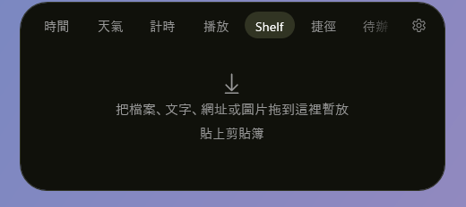
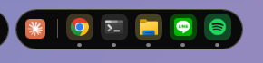
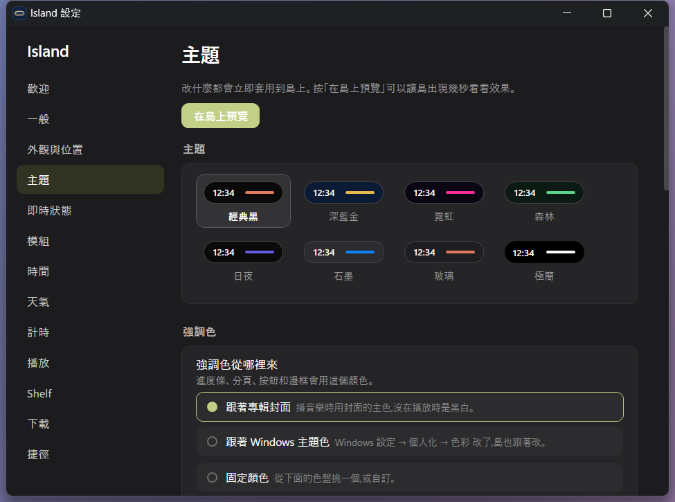

<p align="center">
  
</p>

<h1 align="center">Island</h1>

<p align="center">
  Windows 上的動態島:音樂、時間、捷徑、待辦和各種即時狀態,收在螢幕上方中間的一顆膠囊裡。<br/>
  <sub>A dynamic island for Windows — C# / WPF on .NET 10, near-zero idle CPU.</sub>
</p>

<p align="center">
  <a href="../../releases/latest"><b>下載最新版</b></a> ·
  <a href="docs/DEVELOPMENT.md">開發文件</a>
</p>

<p align="center">
  
  
</p>

## 它會做什麼

平常完全隱藏,不佔畫面;滑鼠推到螢幕上緣中間才滑下來。有事情發生時(換歌、計時到、下載完成、插上電源、麥克風被使用)自己冒出來幾秒,再收回去。

| | |
|---|---|
| **正在播放** | 封面、歌名、進度條、上一首 / 暫停 / 下一首、系統音量;換歌時短暫提示,強調色跟著專輯封面變 |
| **視窗切換** | 捷徑小圓滑鼠停 0.2 秒就往旁邊延伸,列出所有開著的視窗(依程式分組),點一下切過去、中鍵關閉 |
| **Shelf** | 把檔案、文字、網址、圖片拖到螢幕上緣暫放,之後再拖去別的地方;截圖和下載完成的檔案會自動放進來 |
| **時間** | 可換字體、粗細、顏色(可從背景圖取色)、實線 / 玻璃質感,像手機鎖定畫面 |
| **計時 / 番茄鐘** | 剩餘時間在膠囊上的進度環,時間到提醒 |
| **即時狀態** | 像 iPhone 的「小圓 + 長條 + 小圓」:同時有好幾件事時一起顯示 |
| **還有** | 天氣與降雨提醒、行事曆(iCal)、待辦、剪貼簿紀錄、系統監看、音量 / 亮度提示、麥克風與鏡頭使用提示、電量 |
| **快捷鍵** | Ctrl+Alt+I 叫出島;Ctrl+Alt+1…9 直接切到第幾個捷徑;「開始」按鈕可以放在島上 |

<p align="center">
  <br/>
  <sub>捷徑小圓往右延伸,列出開著的視窗</sub>
</p>

### 設定

<p align="center">
  
</p>

深色設定視窗,改什麼都立即套用:8 組主題、強調色來源(專輯封面 / Windows 主題色 / 固定 / 依時段)、膠囊透明度與圓角、每個模組各自開關、設定可以匯出 / 匯入搬到別台電腦。

## 安裝

到 [Releases](../../releases/latest) 下載 `Island-Setup-<版本>.exe` 執行。

- 需要 Windows 10(2004)或 Windows 11,64 位元。不用另外安裝 .NET,也不需要系統管理員權限(只裝給目前的使用者)。
- 安裝程式沒有數位簽章,第一次執行時 SmartScreen 會顯示「Windows 已保護您的電腦」:按「其他資訊」→「仍要執行」。可以用同一頁的 `.sha256` 核對檔案。
- 升級:直接執行新版安裝程式,設定保留。解除安裝:Windows 設定 →「應用程式」→ Island。

## 技術重點

- **C# + WPF,.NET 10**。外殼和 14 個模組分開:模組是 `Island.Modules.*.dll`,啟動時掃描載入,外殼不直接引用任何模組型別;新增模組不用改外殼。
- **閒置幾乎不耗資源**:隱藏時 CPU 約 0.05% 單核、工作管理員記憶體約 20–45 MB。沒有每幀輪詢:時間對齊整分鐘更新;視窗、媒體、麥克風、下載都用系統事件通知(WinEvent hook、SMTC、登錄變更通知、檔案監看),只在需要時掛上。
- **不搶焦點的置頂視窗**:分層 + `WS_EX_NOACTIVATE` 視窗,依螢幕 DPI 定位,螢幕熱插拔、全螢幕偵測(影片、遊戲、簡報時自動讓開)。
- **動畫不抖動**:延伸列的寬度先預留在視窗裡、用整數寬度做動畫,避免分層視窗邊改大小邊算圖造成的抽動。
- **一般使用者權限**:開機啟動寫在 `HKCU\...\Run`,全部資料在 `%LOCALAPPDATA%\Island`。
- **測試**:194 個 xUnit 測試涵蓋純邏輯(視窗分組、行事曆解析、顏色計算、設定正規化、匯入匯出…)。

詳細的操作說明、架構、效能量測和驗收紀錄在 [docs/DEVELOPMENT.md](docs/DEVELOPMENT.md)。

## 從原始碼建置

需要 Windows 10/11 和 [.NET 10 SDK](https://dotnet.microsoft.com/download)。

```powershell
dotnet build Island.sln -c Release
dotnet test Island.sln -c Release
.\src\Island.App\bin\Release\net10.0-windows10.0.19041.0\Island.exe
```

產生安裝程式(需要 [Inno Setup 6](https://jrsoftware.org/isinfo.php)):

```powershell
powershell -ExecutionPolicy Bypass -File tools\build-installer.ps1
```

輸出在 `artifacts\Island-Setup-<版本>.exe`。
